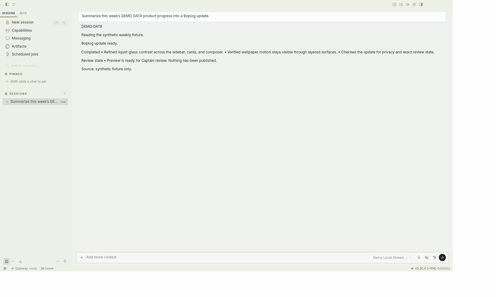
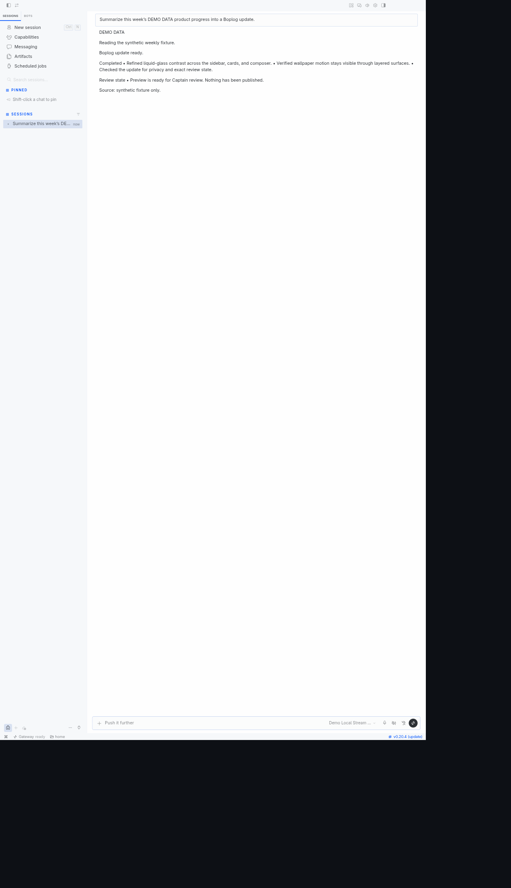

# hermes-liquid-glass

**Linux-native liquid glass** for [Hermes Desktop](https://github.com/NousResearch/hermes-agent):

`Wallpaper Engine / swww` → **verified frame + pywal** → **Hermes Desktop plugin**

When the wallpaper changes, Desktop accent/chrome follow automatically.

> Trailer uses a **synthetic preview chat only** — no real sessions, paths, or personal content.

## Preview

### Horizontal setup

[](./media/preview.mp4)

Native 1920x1080 capture on DP-1 with the configured Wallpaper Engine item
[Forgotten Ruins](https://steamcommunity.com/sharedfiles/filedetails/?id=2133182232)
by Tiamat and Historyk.

### Vertical setup

[](./media/preview-vertical.mp4)

Native portrait 1080x1920 compositor capture on DP-2 with the configured
Wallpaper Engine item [Abstract Landscape](https://steamcommunity.com/sharedfiles/filedetails/?id=1888636115)
by [Ark](https://steamcommunity.com/profiles/76561198095821837).

Both previews capture actual Hermes Desktop and `linux-wallpaperengine` in the
same Wayland compositor path. They use a local deterministic `DEMO DATA`
stream. No external model, private session, or account data is used. Theme by
[kvnloo](https://github.com/kvnloo). See [preview provenance](./docs/PREVIEW_PROVENANCE.md).

## Quick install

```bash
curl -fsSL https://raw.githubusercontent.com/kvnloo/hermes-liquid-glass/main/scripts/install.sh | bash
```

Then in Hermes Desktop:

1. **Cmd/Ctrl+K → Reload desktop plugins**
2. **Settings → Plugins** → enable `liquid-glass-wal` if needed
3. **Cmd/Ctrl+K → Liquid Glass: sync from pywal now**

Clone path defaults to `~/.local/share/hermes-liquid-glass`.  
Override with `HERMES_LIQUID_GLASS_HOME=/somewhere`.

## What you get

| Piece | Path |
|-------|------|
| Theme builder | `scripts/build_theme.py` |
| Apply hook | `scripts/apply.sh` |
| End-user installer | `scripts/install.sh` |
| Desktop runtime plugin | `plugin/plugin.js` |
| Unified-package entrypoint | `desktop/plugin.js` (symlink to the runtime plugin) |
| Hermes CLI manifest | `plugin.yaml` + inert `__init__.py` |
| Hyprland opacity fragment | `hypr/liquid-glass.conf` |
| Trailer (Remotion) | `trailer/` |

## Requirements

- Linux + [Hyprland](https://hyprland.org/) (Hermes remains compositor-opaque)
- [pywal](https://github.com/dylanaraps/pywal) (`wal`)
- [Hermes Desktop](https://github.com/NousResearch/hermes-agent)
- Optional: Wallpaper Engine (`linux-wallpaperengine`) or any wallpaper tool that feeds pywal

## Manual install

```bash
git clone https://github.com/kvnloo/hermes-liquid-glass.git
cd hermes-liquid-glass
./scripts/install.sh
# equivalent: mkdir -p ~/.hermes/desktop-plugins && ln -sfn "$PWD/plugin" ~/.hermes/desktop-plugins/liquid-glass-wal
```

### Hyprland safety boundary

```conf
# ~/.config/hypr/hyprland.conf
source = /absolute/path/to/hermes-liquid-glass/hypr/liquid-glass.conf

# Do not add an opacity rule for Hermes. The shipped fragment keeps the
# window opaque; the plugin composites verified wallpaper pixels itself.
```

### Wire pywal

After every `wal` run:

```bash
/path/to/hermes-liquid-glass/scripts/apply.sh
```

If you use [kvnloo/.files](https://github.com/kvnloo/.files), this is already hooked from `scripts/apply-pywal-theme.sh` when the package is linked.

## How it works

1. `build_theme.py` reads `~/.cache/wal/colors.json`
2. Emits a Hermes `DesktopTheme` (+ glass mix knobs) to:
   - `~/.cache/wal/hermes-liquid-glass-theme.json`
   - `~/.hermes/liquid-glass-wal/theme.json`
3. Runtime plugin polls the file, installs skin `liquid-glass-wal`, paints CSS seeds **without** full-window reload
4. The plugin composites a receipt-bound wallpaper frame inside an opaque window. Missing, stale, or mismatched frames use opaque theme surfaces.

## Palette commands

| Command | Action |
|---------|--------|
| Liquid Glass: sync from pywal now | Force rebuild apply + one reload |
| Liquid Glass: toggle auto-apply… | Enable/disable wallpaper auto-theme |

## Distribution / “store”

There is **no** Hermes Desktop marketplace selector yet. Canonical standalone
delivery remains **git + disk door** (`$HERMES_HOME/desktop-plugins/`). The repo
also follows Hermes' unified package layout (`plugin.yaml`, `__init__.py`, and
`desktop/plugin.js`) so a SHA-pinned community-index install can inventory the
same Desktop plugin without adding an active Python capability.

See [docs/DISTRIBUTION.md](./docs/DISTRIBUTION.md) and [docs/COMMUNITY.md](./docs/COMMUNITY.md) (Discord pitch).

The community index is a CLI discovery/install surface, not a Desktop-native
marketplace. VS Code Marketplace themes are a different system.

## Contributing

See [CONTRIBUTING.md](./CONTRIBUTING.md).

```bash
node --check plugin/plugin.js
./scripts/apply.sh
# Reload desktop plugins in Hermes
```

## Local single-source layout

On this machine (Hermes + optional `.files`):

| Consumer | Points at |
|----------|-----------|
| Hermes live plugin | `~/.hermes/desktop-plugins/liquid-glass-wal` → `./plugin` |
| `.files` package | `config/hermes-liquid-glass` → this repo |
| Theme data (generated) | `~/.hermes/liquid-glass-wal/theme.json` + `~/.cache/wal/…` |

```bash
./scripts/sync-layout.sh
```

## Trailer

Privacy-safe Remotion trailer (demo UI only):

```bash
cd trailer
npm install
npx remotion render src/index.tsx LiquidGlassTrailer out/liquid-glass-trailer.mp4 \
  --browser-executable="$(command -v chromium || command -v google-chrome-stable)"
```

## License

MIT — see [LICENSE](./LICENSE)
